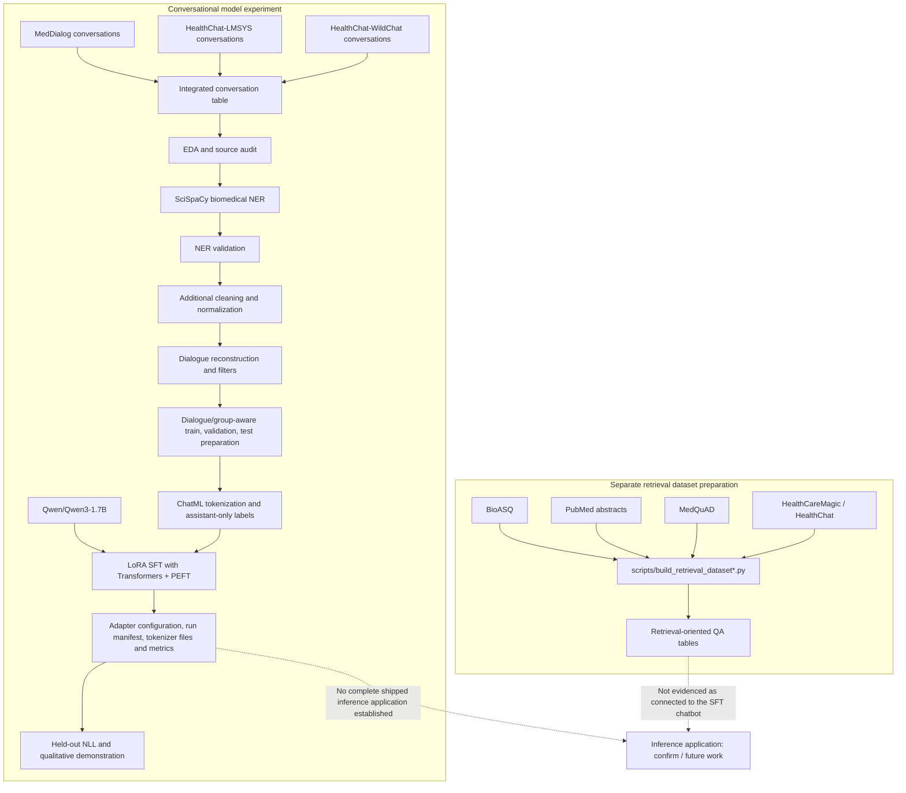
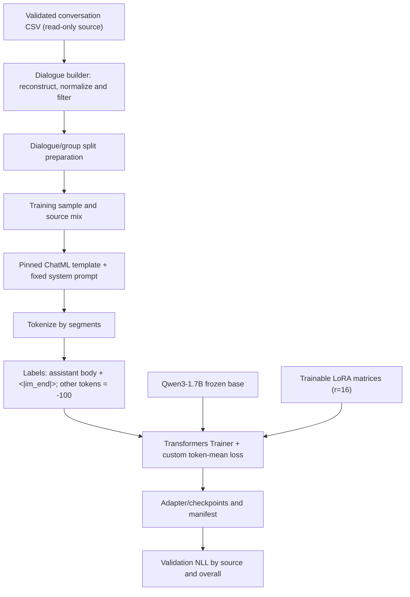
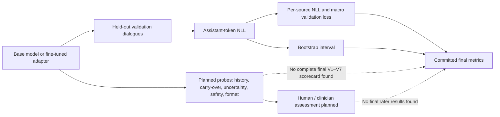
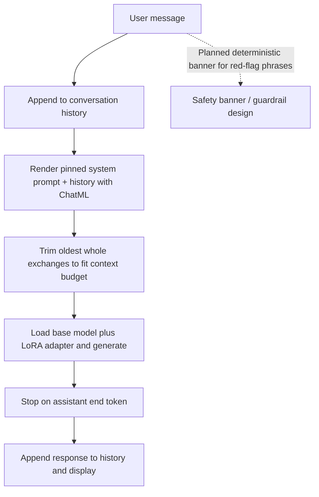

# MEDICAL-AI — Medical Conversational AI

> **College capstone project:** an experimental, fine-tuned conversational language model for general health information.  
> **Important:** This is an academic research project—not a medical device, diagnostic tool, or substitute for a qualified clinician.

## Project status at a glance

The repository documents a completed data exploration and preparation effort, a Kaggle-based Qwen3-1.7B LoRA supervised fine-tuning run, and held-out negative log-likelihood (NLL) results. It also contains early pilot runs and a pre-recorded base-versus-fine-tuned response demonstration. The repository does **not** contain the trained adapter weight file, a complete runnable inference application, or results for the full planned safety and human-evaluation suite.

The most complete run is evidenced by `sft_results_unzipped/run_manifest.json`, `sft_results_unzipped/val_metrics.json`, the saved adapter configuration, and the executed `sft/notebooks/demo_nirmal_llm.ipynb`. It used Qwen3-1.7B with LoRA on a Tesla T4 GPU. Some run metadata and validation counts do not reconcile; those issues are called out below rather than silently resolved.

## Contents

1. [Project overview](#1-project-overview)
2. [Problem statement, motivation, and objectives](#2-problem-statement-motivation-and-objectives)
3. [Key features and current status](#3-key-features-and-current-status)
4. [Technology stack](#4-technology-stack)
5. [System architecture](#5-system-architecture)
6. [Dataset description](#6-dataset-description)
7. [Preprocessing and exploratory data analysis](#7-preprocessing-and-exploratory-data-analysis)
8. [Base-model architecture](#8-base-model-architecture)
9. [Supervised fine-tuning](#9-supervised-fine-tuning)
10. [LoRA and quantization](#10-lora-and-quantization)
11. [Training environment and configuration](#11-training-environment-and-configuration)
12. [Experiments and training results](#12-experiments-and-training-results)
13. [Pilot and final evaluation](#13-pilot-and-final-evaluation)
14. [Inference and chatbot workflow](#14-inference-and-chatbot-workflow)
15. [Repository structure](#15-repository-structure)
16. [Installation and setup](#16-installation-and-setup)
17. [Reproducing the work](#17-reproducing-the-work)
18. [Challenges and engineering decisions](#18-challenges-and-engineering-decisions)
19. [Limitations and future work](#19-limitations-and-future-work)
20. [Medical safety disclaimer](#20-medical-safety-disclaimer)
21. [Contributors and acknowledgments](#21-contributors-and-acknowledgments)
22. [Information to confirm with teammates](#22-information-to-confirm-with-teammates)

---

## 1. Project overview

MEDICAL-AI explores how to adapt an open-weight conversational language model to respond to general health-information questions in a conversational format. The documented fine-tuning path uses **supervised fine-tuning (SFT)** and **LoRA** on the instruction-following checkpoint `Qwen/Qwen3-1.7B`.

The project combines medical conversation data from MedDialog and two HealthChat subsets, adds biomedical named-entity annotations for analysis, and builds a dialogue-aware SFT preparation path. The resulting experiment aims to improve how the model follows a health-information system prompt, responds to user questions, and uses prior turns in a conversation.

This repository contains more than one line of work:

- **Conversational model work:** EDA, conversation validation, biomedical NER, dialogue preparation, LoRA SFT, pilot evaluation, and saved final-run metrics.
- **Retrieval-dataset work:** scripts and a notebook for preparing a separate BioASQ/PubMed/MedQuAD/HealthCareMagic QA dataset. This is a data-building experiment; it does not demonstrate that retrieval or RAG is connected to the fine-tuned chatbot.

The project’s approved technical design is documented in [`docs/ARCHITECTURE.md`](docs/ARCHITECTURE.md). Related proposal documents describe a broader future system, but features such as DPO/RLHF, production safety services, RAG inference, and deployment should not be read as completed implementation.

## 2. Problem statement, motivation, and objectives

### Problem

People often seek understandable information about symptoms, conditions, medications, and health topics. A general conversational model may produce fluent responses, but fluency alone does not ensure that it uses conversation history appropriately, communicates uncertainty, or avoids presenting itself as a clinician.

The project investigates a constrained research question:

> Can a small instruction-following language model be adapted with dialogue examples and assistant-only SFT to better fit the style and structure of general health-information conversations?

This is a **modeling experiment**, not evidence that the resulting model provides clinically accurate or safe medical advice.

### Why conversational AI?

A conversational interface can preserve user-provided context across turns—for example, a previously mentioned allergy or symptom duration—and can ask follow-up questions when important details are missing. Those capabilities are relevant to the project’s intended interaction style. The evaluation plan includes history-use and carry-over probes, but not all planned probes have been scored on the final model.

### Objectives

The documented project objectives are to:

- Explore and audit available medical conversation sources.
- Normalize and validate dialogue structure before modeling.
- Use a pinned, instruction-following open-weight base model.
- Fine-tune the model efficiently with LoRA rather than updating all base parameters.
- Train on assistant responses while masking user and system tokens from the loss.
- Keep training and inference conversation formatting consistent.
- Measure held-out language-model fit and demonstrate example outputs.
- Make the project’s medical, data-quality, licensing, and evaluation limitations explicit.

The intended audience is primarily academic: students, instructors, and developers evaluating or learning from a medical-domain conversational-model experiment.

## 3. Key features and current status

| Component | Status based on repository evidence |
|---|---|
| Conversation EDA and source inspection | Present in notebooks and dataset documentation |
| Biomedical NER extraction and validation | Implemented in notebooks; validated dataset is documented |
| Additional cleaning stages | Implemented in `notebooks/06_cleaning_pipeline.ipynb` and `scripts/run_cleaning_pipeline.py`; completion of every stage/output is not established by committed generated data |
| Dialogue-aware SFT builder | Executed notebook output reports 119,067 dialogues written and per-source conservation closure |
| Duplicate-aware split preparation | Implemented as a notebook; committed split JSONLs and full split audit outputs are not present in the repository tree |
| SFT tokenization and assistant-only mask | Implemented in notebook code; tests and design specify the mask behavior |
| Qwen3-1.7B LoRA SFT | Completed run is evidenced by manifest, adapter configuration, metrics, and demo notebook; adapter weights themselves are not committed |
| Pilot LR experiments | Metrics and manifests are committed under `pilotevals/` |
| Final held-out NLL evaluation | Results are committed under `sft_results_unzipped/` and displayed in the demo notebook |
| Base-versus-fine-tuned examples | Four pre-recorded comparisons in `sft/notebooks/demo_nirmal_llm.ipynb`; qualitative demonstration, not a blinded study |
| Full V1–V7 evaluation gates | Defined in docs and `eval/gates.yaml`; the final report for the full suite is not present |
| Runnable packaged chatbot / `ChatSession` CLI | Described in architecture documentation, but not present as a complete tracked runtime |
| Retrieval-augmented inference | Not shown as connected to the SFT chatbot |

## 4. Technology stack

| Area | Technologies evidenced in the repository |
|---|---|
| Language and analysis | Python, Jupyter Notebook |
| Data processing | pandas, NumPy, scikit-learn, SciPy |
| Visualization and EDA | Matplotlib, Seaborn, Plotly, WordCloud |
| NLP / biomedical NER | spaCy, SciSpaCy `en_ner_bc5cdr_md`, NLTK, `langid` |
| Model and training | PyTorch, Hugging Face Transformers, PEFT |
| Similarity grouping | `datasketch` MinHash / MinHash LSH |
| Data formats | CSV, JSON, JSONL, YAML |
| Training environment evidenced | Kaggle GPU session; Tesla T4, FP16 |

The root `requirements.txt` is an EDA-oriented dependency file and is **not** a complete, validated environment for reproducing the GPU SFT run. The SFT-specific dependency files and recorded library versions are more relevant to that work.

## 5. System architecture

### 5.1 Overall project/data architecture

The diagram separates the executed SFT path from the separate retrieval-data work. Dotted components are proposals or optional paths, not evidence of deployed chatbot behavior.



### 5.2 Dataset-preparation pipeline


The earlier NER validation notebook performs row-level utterance deduplication. The newer SFT preparation path instead emphasizes preserving dialogue integrity and splitting by groups. These are distinct pipeline stages; the latter does not make the earlier row-level deduplication risk disappear.

### 5.3 SFT training pipeline



### 5.4 Evaluation pipeline



### 5.5 Inference workflow

The repository specifies a planned offline ChatML turn loop and red-flag banner in `docs/ARCHITECTURE.md`, and contains pre-recorded generations. It does not include a complete, verified chatbot interface. The intended flow is therefore shown as a design rather than a claim of shipped functionality.



## 6. Dataset description

### 6.1 Conversational dataset sources

The SFT documentation identifies the validated source as:

`data/processed/integrated_conversations_ner_validated.csv`

The source CSV and processed datasets are excluded from Git by `.gitignore`; they are not included in the repository snapshot. Dataset counts below are documented and partly checked by notebook outputs, not independently recomputed here from the absent CSV.

| Source | Documented turns | Documented dialogues | Description |
|---|---:|---:|---|
| MedDialog | 224,328 | 112,164 | Doctor–patient Q&A from HealthCareMagic/iCliniq-derived data; the documented records have exactly two turns per dialogue |
| HealthChat-LMSYS | 28,183 | 6,828 | Health-related user conversations with general-purpose LLMs |
| HealthChat-WildChat | 23,128 | 4,264 | Health-related user conversations with general-purpose LLMs |
| **Total** | **275,639** | **123,256** | Integrated turns across the three sources |

MedDialog is the majority of the raw conversation data and is essentially single-exchange. The multi-turn examples are concentrated in the HealthChat subsets. HealthChat assistant answers are not clinically validated and must not be treated as medical ground truth.

The documented validated CSV schema includes:

- `dialogue_id`: conversation identifier
- `turn_id`: turn position
- `speaker`: `user` or `assistant`
- `utterance`: turn text
- `source_dataset` and `original_id`: source lineage
- `extracted_entities`, `entity_labels`, `entity_count`: biomedical NER information

### 6.2 Important dataset caveats

- The validated-file documentation reports **198 null utterances** and **46,889 rows with no entities**.
- `docs/DATASET.md` reports 778,779 cleaned entity mentions in the validated version.
- MedDialog comprises 112,164 two-turn dialogues, so it contributes no multi-exchange dialogue history by itself.
- NER labels in the original validated file are limited to `DISEASE` and `CHEMICAL`. The later cleaning code supplements these using curated `SYMPTOM`, `ANATOMY`, and `BEHAVIOR` vocabularies.
- LLM-generated HealthChat responses are not clinician-reviewed.
- The source licensing terms are not uniform. MedDialog has no open license declared in project documentation; LMSYS and WildChat have their own terms. Obtain appropriate review before sharing data, weights, or outputs.

### 6.3 Separate retrieval-data work

`notebooks/07_bioasq_pubmed_retrieval_dataset.ipynb`, `scripts/build_retrieval_dataset.py`, and `scripts/build_retrieval_dataset_v2.py` work on a **different QA/retrieval dataset** using BioASQ, PubMed abstracts, MedQuAD, HealthCareMagic, and HealthChat. The scripts describe structured answer types, answer references, PubMed evidence fields, and a Plan-of-Action field.

This branch is not the documented SFT conversation dataset and is not shown connected to model inference. The scripts’ outputs are under `data/processed/`, which is ignored and not committed.

## 7. Preprocessing and exploratory data analysis

### 7.1 EDA and source inspection

The notebook collection includes:

- `notebooks/01_eda.ipynb`: initial project dataset exploration.
- `notebooks/02_edamedquad.ipynb`: MedQuAD and PubMed exploration. The executed cells report 16,412 MedQuAD records, 5,126 unique focus areas, and 2,729 fetched PubMed abstracts in that notebook run. These figures describe that exploratory retrieval workflow, not the SFT conversation corpus.
- `notebooks/03_audit_sanitize_validate.ipynb`: normalization and structural checks for an earlier integrated conversation representation.
- `notebooks/04_scispacy_ner.ipynb`: biomedical entity recognition.
- `notebooks/05_ner_validation.ipynb`: validation and exact duplicate utterance handling.
- `notebooks/06_cleaning_pipeline.ipynb` and `scripts/run_cleaning_pipeline.py`: additional template cleanup, near-duplicate detection, entity normalization, rule-based relabeling, optional UMLS linking, and a spot-check export.

EDA helps reveal source imbalance, nulls, outliers, dialogue length, noisy entity extraction, and templated text before training. It is not itself model evaluation.

### 7.2 NER extraction and validation

The NER notebook uses SciSpaCy’s `en_ner_bc5cdr_md` model and `nlp.pipe()` for batch inference. The model annotates disease and chemical entities and produces pipe-separated entity and label lists aligned by position.

The validation notebook documents these operations:

1. Check expected schema and null values.
2. Parse entity and label lists and identify misalignment.
3. Identify duplicate utterance strings using case-normalized exact matching.
4. Remove noisy entity candidates such as numeric-only strings, stop words, punctuation, and very short tokens.
5. Deduplicate repeated entity mentions within a row.
6. Write a validated CSV and diagnostic summary.

The validated dataset notebook reports a reduction from 276,172 rows to 275,639 after exact duplicate removal (533 rows removed). It also reports that 35 rows had entity/label count mismatches, which were handled during parsing. These are documented notebook outputs; because the data files are not tracked, they cannot be independently re-run from a fresh clone without obtaining the underlying data.

### 7.3 Additional cleaning

The additional cleaning notebook and standalone script describe five stages:

- **Template filtering:** strip ChatDoctor sign-offs and greetings, and remove utterances that consist only of boilerplate.
- **Near-duplicate detection:** MinHash/LSH over character 5-grams, with a Jaccard threshold of 0.85; within a cluster, the longest utterance is kept.
- **Entity normalization:** lowercase and spaCy-lemmatize entity strings; save a raw-to-normalized map.
- **Label improvement:** apply curated vocabulary overrides to reassign some labels to `SYMPTOM`, `ANATOMY`, or `BEHAVIOR`.
- **Optional UMLS linking and review sample:** attempt UMLS CUI linking if the optional model/cache is available, and generate a stratified 200-turn sample for manual annotation.

The code can skip UMLS linking when dependencies or the knowledge-base cache are unavailable. The spot-check file is a review aid; its existence in generated output should not be assumed from the notebook code alone.

### 7.4 SFT dialogue reconstruction and filtering

The SFT pipeline uses one record per dialogue rather than one independent example per turn. The executed `P1b_dialogue_builder.ipynb` shows:

- Turns grouped by `dialogue_id` and ordered by `turn_id`.
- A valid dialogue must have contiguous turn positions, alternating roles beginning with `user`, and non-empty utterances.
- At the first structural defect, the dialogue is cut back to the longest valid prefix ending on an assistant turn. Dialogues with no complete exchange are discarded.
- Text is Unicode-normalized, stripped, and whitespace-normalized.
- Assistant templates and credential claims are filtered or stripped.
- English is detected on the first user turn; code-fence and Markdown-table content is filtered.
- Very short turns and sequences beyond the configured length are excluded or truncated at exchange boundaries.
- The builder records counts by source and drop reason and checks that kept plus dropped dialogues equals the input total.

The executed notebook output reports **119,067 dialogues written**, with source-level accounting:

| Source | Kept | Dropped | Input dialogues |
|---|---:|---:|---:|
| MedDialog | 109,577 | 2,587 | 112,164 |
| HealthChat-LMSYS | 5,924 | 904 | 6,828 |
| HealthChat-WildChat | 3,566 | 698 | 4,264 |
| **Total** | **119,067** | **4,189** | **123,256** |

This is the builder output, not the final training sample count. The model-run manifest records 15,625 train dialogues after selection/filtering. The behavior-set file is reported absent for the saved training run.

### 7.5 Splitting and tokenization

The SFT design and notebooks specify:

- Group exact and near-duplicate dialogues before splitting to reduce leakage.
- Assign a group to exactly one of train, validation, or test.
- Use reproducible hashing/seeds and save manifests/hashes.
- Build a fixed system prompt and ChatML messages.
- Tokenize each dialogue with the model tokenizer.
- Mask system, user, role headers, newlines after message terminators, and padding with `-100`.
- Supervise assistant content and its `<|im_end|>` terminator.
- Truncate at whole exchange boundaries; do not pack examples.

The split notebook code and `eval/gates.yaml` describe extensive split audits and tests. The generated JSONL split files and split report are not included in the repository, so the exact final split sizes and completed audit output cannot be verified solely from tracked files.

## 8. Base-model architecture

### Exact base model

- **Model:** `Qwen/Qwen3-1.7B`
- **Pinned revision:** `70d244cc86ccca08cf5af4e1e306ecf908b1ad5e`
- **Model type:** instruction-following, decoder-only causal transformer
- **Documented architecture:** 28 transformer layers, hidden size 2,048, 16 attention heads and 8 key/value heads (grouped-query attention), vocabulary size 151,936, maximum position setting 40,960
- **License noted in project:** Apache-2.0

The model details are recorded in `docs/P0a_REPORT.md`, model manifests, and the final demonstration notebook. The project selected a relatively small instruct checkpoint that can be used with single-GPU LoRA rather than requiring full-model fine-tuning.

### How the model produces text

1. **Tokenization:** text and ChatML markers are mapped to token IDs.
2. **Token embeddings:** each token ID is converted to a vector representation.
3. **Positional information:** position information lets the model distinguish token order.
4. **Causal self-attention:** each position uses prior context (not future tokens) to calculate which earlier tokens matter. Grouped-query attention shares key/value heads to reduce memory relative to having a separate key/value head for every query head.
5. **Feed-forward layers:** per-token nonlinear transformations enrich the representations between attention operations.
6. **Repeated transformer blocks:** the hidden representation is updated through the 28 layers.
7. **Language-model head:** the final hidden state produces vocabulary logits; softmax probabilities represent the next-token distribution.
8. **Autoregressive generation:** a token is generated, appended to context, and the next-token prediction repeats until a stop token or generation limit.

A simplified causal language-model objective is:

\[
\mathcal{L}(\theta) =
-\frac{1}{N}\sum_{t=1}^{N}\log P_\theta(x_t \mid x_{<t})
\]

In this project’s SFT, the token positions included in the sum are restricted to assistant response tokens and assistant `<|im_end|>` tokens.

### Chat format

The project uses a pinned, thinking-free ChatML format:

```text
<|im_start|>system
{fixed health-information system prompt}<|im_end|>
<|im_start|>user
{user message}<|im_end|>
<|im_start|>assistant
{assistant response}<|im_end|>
```

The format gives the model explicit role boundaries and a consistent prompt structure. The saved training tokenizer configuration indicates `<|im_end|>` is the assistant end-of-turn token and `<|endoftext|>` is used for padding, so padding and end-of-turn IDs are distinct.

## 9. Supervised fine-tuning

### What SFT means here

Supervised fine-tuning trains a pretrained model on examples of the desired input/output behavior. Given a conversation prefix, the model learns to predict the recorded assistant response token by token. SFT does not guarantee factual correctness; it optimizes agreement with the supplied training responses.

### Example construction

Each training item is a complete conversation, not an isolated turn pair. The SFT builder reconstructs turns from `dialogue_id`, sorts them by `turn_id`, validates role ordering, and serializes the valid conversation as user and assistant messages with a fixed system prompt.

### Assistant-only labels and loss

For the serialized sequence, labels are assigned as follows:

| Sequence segment | Label behavior |
|---|---|
| System prompt and system header | Masked (`-100`) |
| User text and user header | Masked (`-100`) |
| Assistant role header | Masked (`-100`) |
| Assistant response tokens | Supervised |
| Assistant `<|im_end|>` | Supervised |
| Trailing newline and padding | Masked (`-100`) |

The cross-entropy objective for supervised token positions is:

\[
\mathcal{L}_{\text{SFT}} =
-\frac{1}{|\mathcal{T}_{A}|}
\sum_{t \in \mathcal{T}_{A}}
\log P_\theta(y_t \mid y_{<t})
\]

where \(\mathcal{T}_{A}\) is the set of assistant-content and assistant-end-token positions. `-100` is the ignore index used by PyTorch cross-entropy.

The tokenization notebooks define checks for tokenization parity, assistant-only supervision, correct end-token handling, truncation behavior, and training/inference prompt parity. The final execution results for every planned test should be verified before treating all gates as passed.

### Training framework

The documented run uses **Hugging Face Transformers Trainer and PEFT**, with a custom token-mean loss implementation in the SFT training notebook. It is not documented as TRL SFTTrainer, Unsloth, full fine-tuning, or QLoRA.

## 10. LoRA and quantization

### LoRA

LoRA (Low-Rank Adaptation) freezes the pretrained model’s weight matrices and learns low-rank updates for selected linear layers. Conceptually:

\[
W' = W + \Delta W,\qquad
\Delta W = \frac{\alpha}{r}BA
\]

where \(W\) is the frozen base weight, \(A\) and \(B\) are trainable low-rank matrices, \(r\) is the rank, and \(\alpha\) scales the update.

The adapter configuration committed in `sft_results_unzipped/adapter_config.json` records:

| Setting | Saved value |
|---|---|
| PEFT method | LoRA |
| Rank \(r\) | 16 |
| Alpha \(\alpha\) | 32 |
| Dropout | 0.05 |
| Target modules | `q_proj`, `k_proj`, `v_proj`, `o_proj`, `gate_proj`, `up_proj`, `down_proj` |
| Bias training | None |
| Task type | Causal language modeling |
| DoRA / RSLoRA | Disabled |

The base model’s weights are frozen and the adapter matrices are trainable. This reduces the number of updated parameters and the optimizer state compared with full fine-tuning. The repository does not include a verified final trainable-parameter count for the completed run.

### Quantization

The evidenced final adapter configuration is **LoRA, not QLoRA**:

- `use_qalora` is false.
- The training manifest says FP16 on the Tesla T4.
- The model is loaded in FP16; the LoRA setup is separate from quantization.
- No evidence in the final run manifest indicates 4-bit NF4 loading or bitsandbytes-based QLoRA.

Quantization is discussed as an option in planning material, but it should not be described as used in the completed run.

## 11. Training environment and configuration

### Where training ran

The run manifest and demo notebook identify the training GPU as a **Tesla T4** in Kaggle. The GPU probe records:

| Hardware property | Recorded value |
|---|---|
| GPU | Tesla T4 |
| Total / free VRAM at probe | 15.64 GB |
| Compute capability | 7.5 |
| BF16 supported | No |
| Training precision | FP16 |

The documentation distinguishes local CPU-based data preparation and checks from GPU-dependent training. The recorded T4 configuration is consistent with FP16. A separate local RTX 3050 is mentioned in planning docs as inadequate for this training workload; it is not the GPU recorded in the final run manifest.

### Most complete run configuration

| Parameter | Final-run evidence |
|---|---|
| Base model | `Qwen/Qwen3-1.7B` |
| Model revision | `70d244cc86ccca08cf5af4e1e306ecf908b1ad5e` |
| Fine-tuning | LoRA SFT, PEFT |
| Precision | FP16 base weights; Tesla T4 |
| LoRA rank / alpha / dropout | 16 / 32 / 0.05 |
| LoRA targets | q/k/v/o projections and gate/up/down projections |
| Learning rate | `2e-4` |
| Epochs | 1 |
| Effective batch | 32 dialogues |
| Micro-batch | 1 |
| Gradient accumulation | 32 |
| Maximum sequence length | 2,048 tokens |
| Seed | 42 |
| Training sample | Manifest reports 15,625 dialogues; configuration budget was 25,000 |
| Behavior-set file | Manifest says `has_behavior_set: false` |
| Optimizer / scheduler | Training design specifies AdamW, weight decay 0, cosine schedule, 3% warmup and gradient clipping at 1.0; the committed final manifest does not independently record every optimizer field |
| Checkpoint frequency | Configuration says save/evaluate every 100 steps; final checkpoint history is not included |
| Training steps | Not stated reliably for final run; manifest has `max_steps: -1` (full epoch) |
| Training duration | Not recorded in committed final-run metrics |
| Final artifact in repository | Adapter configuration and supporting metadata; adapter weight file itself is not committed |

## 12. Experiments and training results

### 12.1 Pilot experiments (`pilotevals/`)

The pilot manifests describe Kaggle T4 runs with a 5,000-dialogue training sample, micro-batch 1, gradient accumulation 32, effective batch 32, 2,048-token cap, rank 16 LoRA, and 150 steps for the LR experiments. The stored manifests also report 400 validation-subset entries, while the JSON metrics show 1,020 total dialogues; this is a metadata discrepancy that needs reconciliation.

| Run | Learning rate | Steps | Overall NLL | Perplexity | MedDialog NLL | HealthChat-WildChat NLL | Macro validation loss |
|---|---:|---:|---:|---:|---:|---:|---:|
| E0 / default pilot | 1e-4 | 50 | 1.813526 | 6.1320 | 2.647842 | 1.145272 | 1.896557 |
| E2a | 5e-5 | 150 | 1.774233 | 5.8958 | 2.606552 | 1.098600 | 1.852576 |
| E2b | 1e-4 | 150 | 1.813526 | 6.1320 | 2.647842 | 1.145272 | 1.896557 |
| E2c | 2e-4 | 150 | 1.713227 | 5.5468 | 2.495682 | 1.077649 | 1.786665 |

Lower NLL is better as a measure of next-token fit to the held-out target text. It is not a measure of medical correctness. The stored pilot files do not provide evidence that the planned GPU memory sweep, overfit test, gradient-accumulation equivalence test, or kill-and-resume acceptance test all completed successfully.

### 12.2 Most complete run and saved final metrics

The final-run manifest records `lr=2e-4`, `max_steps=-1`, and one epoch. The demo notebook identifies this as a full-epoch final run and displays the saved `sft_results_unzipped/val_metrics.json` results.

| Metric | Saved result |
|---|---:|
| Overall validation NLL | 1.651494 |
| Overall perplexity | 5.2148 |
| Macro validation loss | 1.72483 |
| Bootstrap 95% CI for overall NLL | [1.599519, 1.706089] |
| Bootstrap resamples / seed | 1,000 / 42 |
| Dialogue count in overall metrics | 1,020 |
| Supervised tokens in overall metrics | 411,244 |
| HealthChat-WildChat NLL | 1.087809 |
| HealthChat-WildChat dialogues / supervised tokens | 223 / 180,495 |
| MedDialog NLL | 2.361851 |
| MedDialog dialogues / supervised tokens | 500 / 60,371 |
| First-exchange NLL, HealthChat | 1.128726 |
| Later-exchange NLL, HealthChat | 1.083128 |
| Dialogues in each exchange-position statistic | 185 |

The final manifest contains 15,625 training dialogues in its measured field, although the configuration’s sample budget is 25,000. The manifest also records `max_steps: -1`, which indicates no fixed step cap in that configuration; the exact optimizer-step count is not recorded.

**Metric-count caveat:** the final metrics’ overall total of 1,020 dialogues does not equal the sum of the displayed per-source dialogue counts (223 + 500 = 723). The metric JSON also records a 400-dialogue validation subset in the manifest, while the metrics report 1,020. Treat the reported NLL values as committed results, but confirm the metric-generation path and exact validation composition before presenting the counts as reconciled.

### 12.3 Base-model comparison

The demo notebook reports approximate untuned pre-training baseline NLL values from the E0 step-0 evaluation:

| Validation NLL | Approximate base | Final fine-tuned | Change |
|---|---:|---:|---:|
| Overall | 2.1024 | 1.6515 | −0.4509 |
| MedDialog | 3.1200 | 2.3619 | −0.7581 |
| HealthChat-WildChat | 1.4100 | 1.0878 | −0.3222 |

These are described by the demo as a pre-training baseline proxy. They are **not** a separate, independently manifested base-model benchmark run. The change supports improved fit to the held-out dialogue text, not improved clinical accuracy.

### 12.4 Artifacts and missing files

The committed `sft_results_unzipped/` directory contains:

- `adapter_config.json`: LoRA settings and target modules.
- `run_manifest.json`: run configuration, data hashes, GPU and package versions.
- `val_metrics.json`: final validation metrics.
- `gpu_probe.json`: T4 probe data.
- `tokenizer.json`, `tokenizer_config.json`, and `chat_template.jinja`.
- `README.md`: an unfilled model-card template.

It does **not** contain the adapter weights (`adapter_model.safetensors`), full base-model checkpoints, trainer state, full training logs, or checkpoint directories. The notebook demo checks for a locally available adapter under ignored `sft/work/adapter/`; that local artifact is not included in the committed tree. Do not assume the committed results directory alone can load the fine-tuned model.

## 13. Pilot and final evaluation

### Evaluation methodology present

The saved evaluation uses assistant-token NLL on held-out dialogues. NLL is the mean negative log probability the model assigns to target assistant tokens; perplexity is:

\[
\operatorname{PPL} = e^{\operatorname{NLL}}
\]

A macro validation loss is documented as the mean of per-source validation losses. The reported bootstrap interval resamples dialogues 1,000 times with seed 42. First-versus-later exchange NLL is included as a descriptive history-use signal.

The demo notebook also contains four pre-recorded base-versus-fine-tuned examples covering:

1. Headache triage.
2. Penicillin-allergy context carry-over.
3. Emergency escalation for possible stroke symptoms.
4. A request for diagnosis and uncertainty.

These examples are qualitative, selected demonstrations. They are not blinded, clinician-rated, statistically sampled, or sufficient to establish safety.

### Planned versus reported evaluation

`eval/gates.yaml` and the documentation define a broader evaluation plan: held-out NLL, history ablation, constraint carry-over, uncertainty/identity probes, safety probes, format leakage, and preference comparisons. The demo explicitly states that final V3–V5 probe scores and V7 blind human ratings have not been run, and no full final V1–V7 scorecard is committed.

| Evaluation area | Evidence in repository | What can be concluded |
|---|---|---|
| Held-out NLL / perplexity | Pilot and final JSON metrics | The final run has lower reported validation NLL than the E0 pilot |
| Per-source fit | Final JSON metrics for MedDialog and HealthChat-WildChat | Fit differs by source; values are not correctness scores |
| History-use signal | First/later exchange NLL | Later exchanges have lower reported NLL; this is suggestive, not causal proof |
| Base-versus-fine-tuned qualitative output | Four pre-recorded examples | Illustrates response differences only |
| Safety / emergency escalation | Safety gates and probe definitions | A target methodology exists; no final scored results are provided |
| Human or clinician rating | Planned rater sheets and evaluation docs | No completed final rater results are evidenced |
| Medical benchmark accuracy | Proposed in planning docs | No final MedQA/MedMCQA/PubMedQA score table is committed |

## 14. Inference and chatbot workflow

The intended prompt format uses the same fixed system prompt, ChatML serialization, and history-aware context during training and generation. The architecture document describes offline loading, whole-exchange trimming to a prompt budget, and a deterministic red-flag banner.

What is actually present:

- `sft_results_unzipped/chat_template.jinja` and tokenizer metadata.
- A demo notebook showing pre-recorded outputs generated on a Kaggle T4 using greedy decoding, up to 512 new tokens, and repetition penalty 1.05.
- Architecture and evaluation notebooks describing an intended `ChatSession` / CLI pattern.

What is **not** established as shipped:

- A complete executable inference application or chatbot server.
- A committed adapter weight file needed to reproduce the fine-tuned generations.
- A deployed safety router, verified clinician review workflow, or production guardrails.
- A RAG-connected inference path.

Therefore, the response examples in the demo are useful for presentation but are not a fresh inference run reproducible from a clean clone of this repository.

## 15. Repository structure

```text
.
├── .gitignore
├── .kiro/
│   ├── specs/capstone-impl/tasks.md      # implementation checklist
│   └── steering/capstone-rules.md        # project rules and authority order
├── docs/
│   ├── ARCHITECTURE.md                   # approved SFT architecture and design
│   ├── AUDIT.md                          # forensic audit notes and caveats
│   ├── DATASET.md                        # validated NER dataset schema/statistics
│   ├── DATAPIPE.md                       # broader proposed data pipeline
│   ├── EVAL.md                           # broad planned evaluation/safety suite
│   ├── FINETUNE_RL.md                    # broader proposed alignment strategy
│   ├── IMPLEMENTATION_PLAN.md            # implementation stages and setup
│   ├── P0a_REPORT.md                     # environment/model/tokenizer checks
│   ├── PROJECT.md                        # broader project blueprint
│   └── PaperLinks.docx                   # project reference document
├── eval/
│   └── gates.yaml                        # planned/frozen evaluation thresholds
├── gpu_probe.json                        # recorded Tesla T4 GPU probe
├── notebooks/
│   ├── 01_eda.ipynb                      # initial EDA
│   ├── 02_edamedquad.ipynb               # MedQuAD/PubMed EDA
│   ├── 03_audit_sanitize_validate.ipynb  # earlier dialogue normalization
│   ├── 04_scispacy_ner.ipynb              # biomedical NER extraction
│   ├── 04_scispacy_ner_kaggle.ipynb       # Kaggle-oriented NER variant
│   ├── 05_ner_validation.ipynb            # entity and duplicate validation
│   ├── 06_cleaning_pipeline.ipynb         # deeper cleaning stages
│   ├── 07_bioasq_pubmed_retrieval_dataset.ipynb # separate retrieval QA data
│   ├── demo_code.ipynb                    # recorded model demo (same notebook content as SFT demo)
│   └── finetune_qwen3_kaggle.ipynb        # Kaggle LoRA SFT workflow
├── pilotevals/
│   ├── run_manifest*.json                # pilot configurations
│   └── val_metrics*.json                 # pilot validation metrics
├── requirements.txt                      # root analysis/EDA dependencies
├── scripts/
│   ├── build_retrieval_dataset.py         # retrieval dataset v1
│   ├── build_retrieval_dataset_v2.py      # retrieval dataset v2
│   └── run_cleaning_pipeline.py           # standalone conversation cleaning pipeline
├── sft/
│   ├── README.md                          # CPU/Kaggle setup notes
│   ├── AMENDMENTS.md                      # documented implementation amendments
│   ├── config/
│   │   ├── families.yaml                  # behavior/probe scenario families
│   │   └── system_prompt_v1.txt            # fixed health-information system prompt
│   ├── kaggle/
│   │   ├── README.md                       # Kaggle pilot procedure
│   │   └── p3_kaggle_notebook.ipynb        # GPU checks and pilot tests
│   ├── notebooks/
│   │   ├── P1a_g1_e1_profile.ipynb         # dataset gate and profiling
│   │   ├── P1b_dialogue_builder.ipynb      # dialogue reconstruction and filtering
│   │   ├── P2a_splits.ipynb                # duplicate groups and split preparation
│   │   ├── P2b_behavior_probes.ipynb       # behavior examples and evaluation probes
│   │   ├── P3_tokenize_mix.ipynb            # ChatML tokenization and masks
│   │   └── util/                           # notebook utilities and checks
│   ├── logs/preflight.log                   # preflight environment record
│   ├── model_manifest.json                  # pinned base-model snapshot hashes
│   ├── load_check.json                      # local model-load check (partial/fail)
│   ├── protected_manifest.json              # protected-file checksum manifest
│   ├── test_results.txt                     # CPU smoke-test output
│   ├── verify_manifest.py                   # manifest verification utility
│   ├── requirements-*.txt                   # CPU, notebook, GPU and Kaggle dependencies
│   └── freeze*.txt                          # recorded environment freezes
└── sft_results_unzipped/
    ├── README.md                            # incomplete model-card template
    ├── adapter_config.json                  # saved LoRA configuration
    ├── chat_template.jinja                  # saved chat template
    ├── gpu_probe.json                       # run GPU information
    ├── run_manifest.json                    # final-run metadata
    ├── tokenizer.json                       # tokenizer artifact
    ├── tokenizer_config.json                 # tokenizer configuration
    └── val_metrics.json                     # final validation metrics
```

The `data/` directory, model checkpoints, adapter weights, and generated SFT JSONL files are ignored or absent from the committed tree. The README therefore describes these as external/private or generated artifacts, not files that a fresh clone contains.

## 16. Installation and setup

### 16.1 Clone and inspect

```bash
git clone https://github.com/Nirmitmistry/MEDICAL-AI.git
cd MEDICAL-AI
```

The source conversation CSVs and model weights are not included in the public Git tree. Obtain authorized copies through the project team and follow the relevant source terms before attempting data preparation or training.

### 16.2 EDA environment

The root requirements file is intended for data exploration and notebook work:

```bash
python -m venv .venv
# macOS / Linux
source .venv/bin/activate
# Windows PowerShell:
# .venv\Scripts\Activate.ps1

python -m pip install --upgrade pip
pip install -r requirements.txt
```

**Caution:** `requirements.txt` includes `.docx` and `.doc` lines and embedded command text noted in `docs/P0a_REPORT.md`. It may not install successfully as-is. The report also records environment and package compatibility problems with installing SciSpaCy on Python 3.13. Use a compatible, team-verified environment for the older biomedical NER dependencies rather than assuming this root file is a reproducible lockfile.

### 16.3 SFT CPU-preparation environment

The SFT README documents a CPU environment for notebook-based data preparation and checks. On Windows PowerShell:

```powershell
python -m venv sft/.venv
sft/.venv/Scripts/pip install --no-cache-dir -r sft/requirements-cpu.txt
```

The tokenizer snapshot and datasets are local/private assets; the manifest notes they are not committed. The repository’s SFT setup guide describes tokenizer verification, notebook execution, and protected-manifest checks. Some referenced generated files and scripts are not in the tracked tree, so verify their availability with the team before following the procedure verbatim.

### 16.4 Kaggle GPU training environment

The saved run evidence identifies Kaggle and a Tesla T4. The documented process requires private Kaggle datasets for model weights, training files, and code. `sft/kaggle/README.md` describes the pilot notebook setup. `notebooks/finetune_qwen3_kaggle.ipynb` documents the fine-tuning notebook configuration.

Training requires CUDA, GPU-compatible PyTorch, Transformers, PEFT, and Accelerate versions matching the run manifest. It is not a one-command local training setup.

## 17. Reproducing the work

### Re-run exploration/preprocessing

1. Obtain the permitted raw and processed data assets; the `data/` files are not committed.
2. Review notebook paths and expected input names.
3. Run EDA notebooks as needed.
4. Run the NER and validation notebooks only in a compatible SciSpaCy environment.
5. Review the additional cleaning pipeline outputs and its row-level effects.
6. Re-run the SFT dialogue builder and split/tokenization stages; retain manifests and hashes.
7. Confirm split counts and all cross-split duplicate audits before training.

A representative cleaning command from the script documentation is:

```bash
python scripts/run_cleaning_pipeline.py
```

It expects `data/processed/integrated_conversations_ner_validated.csv` and writes generated files under the ignored `data/processed/` directory.

### Re-run SFT

The training notebooks expect private model/data/code datasets attached to a Kaggle notebook, CUDA GPU availability, and offline local model loading. The committed final-run metadata can guide configuration, but the absence of the final adapter weights, trainer state, exact training logs, complete input data, and split JSONLs prevents exact end-to-end reproduction from this public repository alone.

For a reproducible rerun, archive and record:

- Exact train/validation JSONL files and hashes.
- Complete split manifest and data-preparation report.
- Adapter weights and checkpoint selection details.
- Trainer logs and final step count.
- GPU probe and exact package freeze.
- A metrics report with reconciled dialogue/token counts.
- Evaluation probe and rater results, where applicable.

### Re-run retrieval dataset generation

The retrieval scripts expect source files under `data/raw/` and `data/processed/`, also not committed. For example:

```bash
python scripts/build_retrieval_dataset.py
python scripts/build_retrieval_dataset_v2.py
```

The second script expects the v1 output plus the validated conversation CSV and additional libraries. These commands create a separate retrieval-oriented dataset; they do not train or launch the SFT chatbot.

## 18. Challenges and engineering decisions

- **Noisy source text:** MedDialog contains templated provider sign-offs and doctor-persona phrasing; HealthChat has unvalidated LLM responses and may include tables or formatting artifacts.
- **Dialogue integrity:** removing individual turns can break a conversation. The SFT builder reconstructs dialogues and truncates at exchange boundaries.
- **Duplicate leakage:** repeated or near-duplicate examples can inflate held-out scores. The SFT split design uses exact hashes, MinHash, and group-aware assignment.
- **NER limitations:** BC5CDR labels only disease and chemical classes; the project adds rule-based categories and documents optional UMLS linking.
- **Compute constraints:** a 1.7B model is more practical for a single-GPU LoRA experiment than full fine-tuning. The saved T4 supports FP16 but not BF16.
- **Long context and memory:** the SFT setup caps sequences at 2,048 tokens and uses micro-batch 1 plus gradient accumulation 32 in the final manifest.
- **Reproducibility:** pinned model revision, hashes, fixed seed, prompt/template hashes, manifests, and smoke tests help identify drift.
- **Evaluation scope:** language-model fit is measurable from the saved results; medical correctness and safety require separate benchmark and human evaluation.
- **Data availability:** large datasets and model weights are deliberately absent from the Git repository, which makes the public repository insufficient for an exact fresh-clone reproduction.

## 19. Limitations and future work

### Current limitations

1. **NLL is not medical accuracy.** The final result shows improved fit to held-out text, not a clinically validated answer.
2. **The evaluation is incomplete.** Full safety probe results, blinded pairwise human ratings, clinician review, and benchmark accuracy are not committed.
3. **Metric counts need reconciliation.** The final metric total and per-source counts do not add up, and the manifest’s validation count differs from the metric JSON’s overall count.
4. **The model artifact is incomplete in Git.** Adapter configuration is present; adapter weights are not.
5. **The chatbot runtime is not packaged.** The repository describes an intended inference session but does not provide a complete runnable product.
6. **Training provenance has gaps.** Exact final step count, duration, trainer state, and final checkpoint selection log are unavailable.
7. **Training set size differs from budget.** The manifest’s train count is 15,625 while the configuration budget is 25,000.
8. **Behavior data was absent in the reported run.** The manifest records `has_behavior_set: false`.
9. **Data source bias and licensing risks remain.** Source coverage and terms vary, and LLM-generated responses may contain errors.
10. **Not a clinical system.** The model is small, can hallucinate, and has not been validated with clinicians for real-world use.

### Future work

- Reconcile final evaluation counts, artifacts, and run metadata.
- Publish a complete model card and reproducibility bundle consistent with applicable licenses.
- Run the full held-out safety, uncertainty, context carry-over, privacy, and format evaluation.
- Obtain blinded human and qualified clinician review before making any behavioral or clinical claims.
- Add benchmark comparisons against the untuned base model using the same fixed evaluation protocol.
- Build and test a minimal offline inference CLI only after adapter weights and exact tokenizer/template artifacts are available.
- Consider retrieval integration as a separately evaluated extension; the existing retrieval data work is not currently connected to inference.
- Review licensing, privacy, and sensitive-data obligations before any public release of datasets, weights, or model outputs.

## 20. Medical safety disclaimer

**This project is for education and research only. It is not medical advice and is not a substitute for professional medical care.** The model may generate inaccurate, incomplete, or unsafe information. It must not be used to diagnose conditions, prescribe or change medication, determine dosing, or make decisions during emergencies.

If someone may be experiencing a medical emergency, contact local emergency services or seek immediate professional care.

## 21. Contributors and acknowledgments

### Student team

- **Student 1: Nirmit Mistry 
- **Student 2: Shilpa Devi 
- **Student 3: Neel Patel 

### Faculty supervisor

- **Faculty supervisor:** `[Name, title, department]`

### Acknowledgments

The project builds on open-source tools and research infrastructure from the Hugging Face Transformers and PEFT teams, PyTorch, spaCy/SciSpaCy, and the contributors and maintainers of the referenced datasets. Please confirm dataset citations and license requirements before publication or redistribution.
