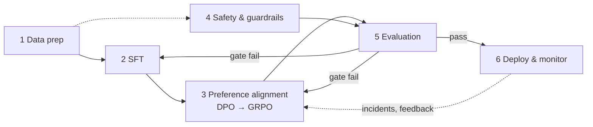
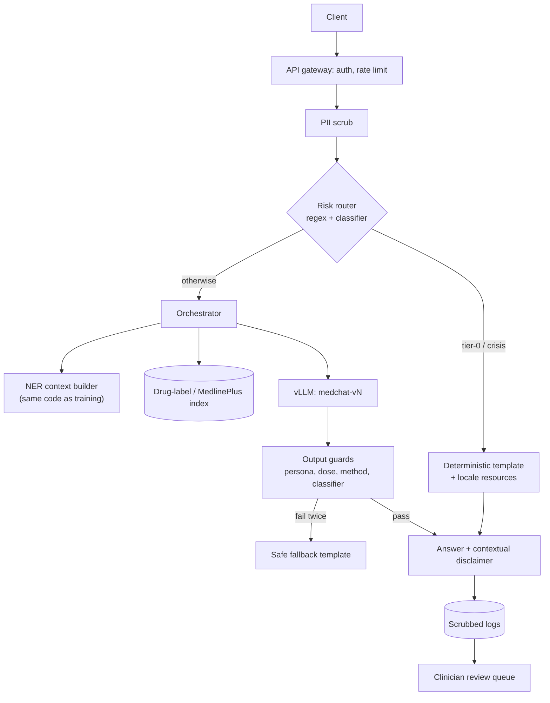

# PROJECT_PLAN.md — MedChat: medical conversational AI

**Lifecycle:** Data prep → SFT → RL preference alignment → Safety/guardrails → Evaluation → Deployment
**Companions:** `DATA_PIPELINE.md` · `FINE_TUNING_RL_STRATEGY.md` · `EVALUATION_SAFETY.md`
**Status:** v1.0 blueprint · external facts (licences, library APIs) last checked 2026-10-23
**Caveat:** clinical thresholds here need sign-off from a licensed clinician. Licence notes are engineering flags for counsel, not legal conclusions.

---

## 0. Mission, scope, non-goals
- **Mission:** an AI assistant that gives accurate, empathetic *health information* in multi-turn chat, asks for missing context, escalates emergencies and crises, and never impersonates a clinician.
- **In scope (v1):** English text chat · symptoms / conditions / medications / lab values · triage guidance (self-care · routine · urgent · emergency) · crisis routing.
- **Out of scope (v1):** diagnosis or prescribing · image/audio · non-English · clinician-facing decision support · PHI/EHR integration.

## 1. What the dataset reference implies (read first)

| # | Fact (from `integrated_conversations_*`) | Risk | Design decision | Detail |
|---|---|---|---|---|
| 1 | MedDialog = 112,164 dialogues / 224,328 turns → **exactly 2 turns each, 91.0% of all dialogues**. Only HealthChat's 11,092 dialogues (51,311 turns; 4.1 turns/dlg LMSYS, 5.4 WildChat) are multi-turn | Model learns "answer immediately"; weak context tracking | One training sample per *dialogue*, loss on every assistant turn; upweight HealthChat; synthetic clarify→answer; dialogue-level eval slice | DATA §4, §11 |
| 2 | MedDialog replies = telemedicine-marketplace physician text (Tier A) | Persona ("Dr X"), lead-gen, sign-offs, confident dx from a paragraph, specific doses | Rewrite-to-Assistant (R2A) + gates; raw replies reused as DPO *rejected* | DATA §6, FT §3 |
| 3 | HealthChat assistant turns = unvalidated LLM output from mixed generators (Tier B) | Imitating hallucinations / weak-model style | Recover generator `model` via `original_id`; judge + claim gating; use as candidates, not gold | DATA §2, §6 |
| 4 | BC5CDR knows DISEASE/CHEMICAL only; clean file adds SYMPTOM/ANATOMY/BEHAVIOR; 829 strings carry both labels (50,208 + 19,660 − 69,039); max 122 entities/turn (table artefacts) | Noisy tags; entity-metric inflation | Condition on **user-side entities only**, with dropout/noise; CUIs = pipeline keys | DATA §5, §10 |
| 5 | Template artefacts (`chatdoctori`), canned near-dup replies, 198 null utterances | Memorised boilerplate; split leakage | Re-verify nb06 stages; split on near-dup *groups*, not rows | DATA §3, §7 |
| 6 | nb06 drops/dedups at *turn* level; 137,880 assistant vs 137,759 user turns implies ~121 role-order anomalies (if MedDialog is strictly user→assistant) | Orphan turns, broken alternation | Structural repair pass + tests | DATA §3 |
| 7 | Reference numbers disagree slightly (46,889 entity-less turns stated vs ≈48.7k implied by per-source coverage) | Silent misparse | Audit asserts reconcile before any training | DATA §1 |
| 8 | Three data licences + upstream generator terms | Release exposure | Lineage tags, research vs commercial tracks, CI licence gate | §8 |

## 2. Principles
1. **Dialogue-first:** the unit of data, split and loss is the dialogue.
2. **Trust tiers:** A = clinician text (noisy style) · B = unvalidated LLM text · C = synthetic + verified. Never treat B as ground truth.
3. **Entity-aware, not entity-dependent:** NER tags are hints with dropout; the user's words win.
4. **Safety is a gate, not a feature:** tier-0 emergencies and crises get deterministic templates; model-only safety is measured separately.
5. **Lineage everywhere:** each row carries source, tier, licence track, generator model, split.
6. **Evaluate before scaling:** every stage has a quantitative exit gate; failing a gate loops back, it doesn't ship.

## 3. Lifecycle



### Phase 1 — Data preparation (weeks 1–3)
- **Tasks:** load + audit (DATA §1) · tagging + generator-model recovery (§2) · structural repair (§3) · entities, flags, intent (§5) · quality scoring + R2A + clinician audit (§6) · group-aware split + decontamination (§7, §9) · render + masks (§8, §10) · mixture + preference-prompt bank (§11) · data card (§12).
- **Deliverables:** `data/sft/v1/{train,val,test}.jsonl`, `data/pref/v1/prompts.jsonl`, `manifest.json`, `docs/DATA_CARD.md`.
- **Exit gate:** all audit asserts pass · 0 group overlap across splits · template residue < 0.5% of assistant turns · persona-claim rate < 1% · R2A acceptance ≥ 85% · clinician audit (n=200) ≥ 90% "safe & acceptable".

### Phase 2 — SFT (weeks 3–5)
- **Tasks:** 2.0 base-model bake-off (3 days, FT §1) · 2.1 LoRA SFT · 2.2 ablations A1–A6 · 2.3 checkpoint selection + merge.
- **Exit gate:** ≤ 2-pt regression vs base on MedQA/MedMCQA/PubMedQA/MMLU-clinical · judge win-rate vs base ≥ 55% on in-domain test · persona ≤ 1% · no triage-suite regression.

### Phase 3 — RL preference alignment (weeks 5–8)
- **Tasks:** prompt bank + on-policy sampling (K=8) · composite scoring · pair mining (8 generators) · DPO · optional GRPO · ORPO ablation (FT §3).
- **Exit gate:** judge win-rate vs SFT ≥ 60% (position-swapped) · unsupported-claim rate ↓ ≥ 20% relative · model-only emergency-escalation recall (EER) ≥ 0.98 · length growth ≤ 15% · over-refusal ≤ 5%.

### Phase 4 — Safety & guardrails (weeks 6–9, parallel)
- **Tasks:** policy spec + clinical review · risk detector + classifier · templates + locale table · dose/persona/method guards · red-team rounds · legal review (EVAL §8–9).
- **Exit gate:** guardrail unit tests 100% · system-level EER ≥ 0.995 · crisis checklist adherence ≥ 0.98 · method disclosure = 0 · child-dose leak = 0.

### Phase 5 — Evaluation (weeks 8–10, continuous)
- **Tasks:** full suite on the release candidate (EVAL §1–7) · clinician review (≥ 300 conversations, 2 raters) · fairness + privacy tests · scorecard sign-off.
- **Exit gate:** every row of EVAL §10 green.

### Phase 6 — Deployment (weeks 10–12+)
- **Tasks:** serve (vLLM) + guardrail sidecar + RAG · canary 5% → 25% → 100% · monitoring + alerts · clinician review queue · incident runbook · rollback drill (§9).
- **Exit gate:** p95 latency SLO met · 14-day canary with zero SEV1 · rollback drill passed.

## 4. Repository layout
```
medchat/
├── PROJECT_PLAN.md  DATA_PIPELINE.md  FINE_TUNING_RL_STRATEGY.md  EVALUATION_SAFETY.md
├── configs/{data,sft,dpo,grpo,deepspeed,accelerate,guardrails}/
├── data/{raw,processed,sft/v1,pref/v1,eval}/      # DVC-tracked; never committed to git
├── notebooks/01..06_*.ipynb                        # existing
├── src/medchat/
│   ├── data/    audit repair tag entities quality r2a split render masking mixture
│   ├── safety/  risk guard templates
│   ├── train/   sft dpo grpo rewards build_pairs weighted_trainer
│   ├── eval/    judge entity_metrics halluc safety_suite
│   └── serve/   app
├── tests/  scripts/  docs/{DATA_CARD,MODEL_CARD,CLINICAL_REVIEW_LOG}.md
```

## 5. Decision records (defaults)

| Decision | Default | Alternatives | Revisit when |
|---|---|---|---|
| Base model | `Qwen/Qwen3-8B` (Apache-2.0), *instruct* checkpoint, non-thinking mode | Qwen2.5-7B-Instruct · Mistral-7B-Instruct-v0.3 (check cards) · Llama-3.x-8B-Instruct (AUP medical clause → legal first) | Phase 2.0 bake-off, or a newer Apache-2.0 7–9B release |
| Tuning | bf16 LoRA r=64, all-linear | QLoRA (< 40 GB VRAM) · full FT (≥ 8×80 GB) | Ablation A5 shows ≥ 2-pt gap |
| Data format | Canonical `messages` JSONL → model's own chat template (ChatML for Qwen); ShareGPT exporter | Axolotl/LLaMA-Factory ShareGPT | Toolchain change |
| Conditioning | User-side entities + risk flags in `<clinical_context>`, with dropout | None (ablation A2) | A2 shows no gain |
| Alignment | SFT → DPO (+ SFT term) → optional GRPO | ORPO single-stage (ablation) | DPO plateau |
| Safety | Deterministic tier-0/crisis templates + output guards | Model-only | Never for tier-0 |
| Licence track | `research` default; `commercial` requires a MedDialog-free retrain | — | Legal clearance |

## 6. Compute (order-of-magnitude; replace after a 200-step pilot per stage)
Assumptions: 8×A100-80GB/H100 node; ~350 tokens per MedDialog dialogue, ~1,800 per HealthChat dialogue → ≈ 60–70M tokens per SFT epoch (measure with `scripts/token_stats.py`).

| Stage | Estimate |
|---|---|
| SFT, LoRA, 2 epochs | ~10–30 GPU-hours |
| DPO, ~50k pairs, 2 epochs | ~20–60 GPU-hours |
| GRPO, ~1.5k steps, K=8 (generation + judge dominate) | ~150–400 GPU-hours |
| Full eval suite per release candidate | ~10–20 GPU-hours + judge calls |

## 7. Risk register

| Risk | L | I | Mitigation | Owner |
|---|---|---|---|---|
| Model learns doctor persona / lead-gen | H | H | R2A, persona gate, DPO persona pairs, output guard | ML |
| Confident dosing from MedDialog imitation | H | H | Dose scrub in R2A, child-dose gate, DoseGuard + label RAG | ML + Clinical |
| Emergency under-triage | M | Critical | Tier-0 templates, recall-first regex + classifier, EER gate ≥ 0.995 | Safety |
| Reward hacking (verbosity, entity stuffing, judge exploits) | H | M | Length penalty, density band, judge ensemble, held-out judge, KL anchor | ML |
| Split leakage → inflated results | M | H | Group-aware split, decontamination, leakage tests in CI | Data |
| Licence breach on release | M | H | Lineage tags, licence gate, counsel review, MedDialog-free track | Legal |
| Sycophancy to leading questions | M | M | PP6 pairs + S6 eval suite | ML |
| Privacy regurgitation | L | H | PII scrub, canary tests, verbatim-overlap test | Safety |
| Judge/clinician disagreement | M | M | Calibration set, κ ≥ 0.6 before judge gates count | Eval |
| Quantisation silently changes behaviour | M | H | Re-run safety suite on the *served* artifact | MLOps |

## 8. Licence & compliance gates
Not legal advice. Counsel must review before any release or sharing of data, weights or outputs.

| Component | Terms (see "verified facts" note) | Action |
|---|---|---|
| MedDialog slice (likely HealthCareMagic-100k from ChatDoctor, ~112k exchanges) | No open licence declared; platform copyright; ChatDoctor describes itself as academic-research only | `research_only`; never redistribute raw text; weights research-only until cleared; keep a MedDialog-free retrain path |
| HealthChat-LMSYS | LMSYS-Chat-1M agreement: no transfer to third parties; no identifying individuals or inferring sensitive personal data | Don't redistribute; no geo/IP joins; counsel to confirm health-entity tagging of user turns is compatible; keep deletion-retrain capability |
| HealthChat-WildChat | Your reference cites ImpACT-LR (WildChat-nontoxic); the WildChat-1M card lists ODC-BY since 2024-06-26 | Record which variant you used; attribute and cite the paper; stricter reading governs until confirmed |
| Upstream generators (assistant turns) | GPT-3.5/4, Llama-derived models etc. may carry output terms | Include in counsel review |
| Base model | Qwen3-8B Apache-2.0. Llama AUP bars unlicensed practice of medical/health professions and passing outputs off as human; derivatives must be named "Llama…" | Prefer Apache-2.0; Llama only after legal sign-off |
| Teacher / judge models | API ToS may restrict training on outputs | Prefer open-weights teachers whose licence permits it |
| Regulation | Health-information vs software-as-medical-device classification varies by jurisdiction | Regulatory review before launch; keep claims "information, not diagnosis" |

## 9. Deployment architecture (Phase 6)



```bash
# merged artifact (re-run the full safety suite on exactly this artifact, incl. any quantisation)
vllm serve ./artifacts/medchat-v1-merged --served-model-name medchat-v1 \
  --dtype bfloat16 --max-model-len 8192 --gpu-memory-utilization 0.90 --enable-prefix-caching
# or serve the adapter: add  --enable-lora --lora-modules medchat=./artifacts/medchat-v1-lora
```
- **SLOs:** p95 time-to-first-token and end-to-end latency set from the canary; guard-intervention rate, tier-0 trigger rate, fallback rate and regeneration rate on dashboards.
- **Rollout:** shadow → 5% → 25% → 100%, with an automatic kill-switch to template-only mode on SEV1. Retrain cadence is event-driven: incidents and feedback become new preference pairs.

## 10. MLOps & reproducibility
Pin `python`, `torch`, `transformers`, `trl`, `peft`, `deepspeed`, `vllm`, `accelerate` in `requirements.lock`. Use DVC for data, W&B or MLflow for runs, and a model registry keyed by (data manifest hash, config hash, git SHA, base-model revision). Fix seeds. Every artifact has a model card and data card. CI blocks merges on failing data/guardrail tests and blocks releases on a failing scorecard or licence gate.

## 11. Definition of done (v1.0)
- [ ] Data card and manifest signed off; clinician audit logged
- [ ] SFT + DPO checkpoints pass EVAL §10
- [ ] Guardrails pass 100% unit tests and system-level EER
- [ ] Licence track decided and recorded; counsel sign-off on file
- [ ] Canary clean for 14 days; rollback drill passed